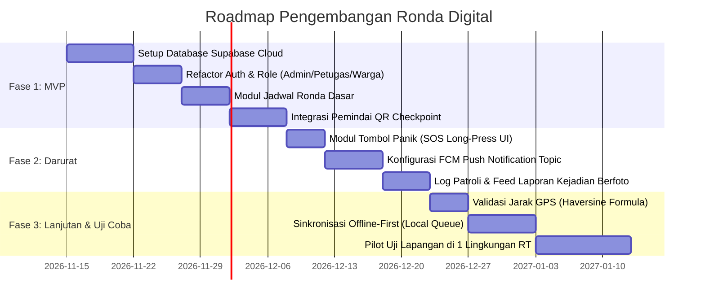

# PRODUCT REQUIREMENT DOCUMENT (PRD)
## Transformasi SensorLog Menjadi Ronda Digital (Siskamling Modern RT/RW)

---

### Informasi Dokumen
- **Judul Produk**: Ronda Digital — Siskamling Modern Lingkungan RT/RW
- **Inisiator / Pengembang**: Kelompok 4 · Teknik Komputer ITS
- **Basis Kode Awal**: Aplikasi `SensorLog` (`Tugas-4` Flutter Mobile App)
- **Status**: Perencanaan Arsitektur & Spesifikasi Kebutuhan Teruji (PRD v3.0 - QA Reviewed)
- **Target Platform**: Android & iOS (Flutter), Cloud Backend (Supabase PostgreSQL + Realtime) dengan Mesin Resiliensi Dual-Mode (Offline-First Local Queue)

---

## 1. Latar Belakang & Masalah

### 1.1 Masalah Siskamling Konvensional
Berdasarkan temuan lapangan pada sistem ronda lingkungan RT/RW saat ini:
1. **Jadwal Sering Lupa & Tukar Giliran Repot**: Pembagian giliran manual via kertas/grup WhatsApp sering terlewat, miskomunikasi, dan sulit mencari pengganti saat warga berhalangan.
2. **Tanpa Bukti Patroli Nyata**: Tidak ada verifikasi apakah petugas benar-benar berkeliling ke titik rawan (pos ronda, gang buntu, portal) atau hanya diam di pos ronda.
3. **Peringatan Lambat saat Kondisi Kritis**: Penggunaan kentongan atau pesan WhatsApp sering terlambat terbaca saat terjadi pencurian, kebakaran, atau kecurigaan tindak kriminal malam hari.
4. **Ketiadaan Riwayat & Arsip Laporan**: Catatan kejadian hilang begitu saja tanpa histori analitik untuk evaluasi keamanan lingkungan oleh pengurus RT.

### 1.2 Solusi: Ronda Digital
Memodifikasi fondasi aplikasi pencatat lapangan **SensorLog** yang sudah memiliki modul GPS, kamera, dan sensor perangkat menjadi aplikasi operasional keamanan lingkungan terpadu yang menyediakan:
1. **Jadwal Otomatis & Fleksibel**: Pembagian shift adil, push reminder terjadwal, dan fitur pengajuan tukar giliran antarwarga.
2. **Check-in Checkpoint Berbasis QR Code + GPS**: Verifikasi kehadiran patroli di pos/titik pantau secara objektif dengan time-based token dan validasi radius geofencing.
3. **Tombol Panik Terintegrasi (SOS Alert)**: Broadcast sirine darurat dan koordinat presisi langsung ke seluruh smartphone warga dalam radius RT/RW menggunakan Firebase Cloud Messaging (FCM).
4. **Log Patroli & Riwayat Kejadian Real-time**: Dashboard pemantauan dan laporan investigasi berfoto untuk Ketua RT.

---

## 2. Audit Kode & Strategi Transformasi Basis Kode SensorLog (`Tugas-4`)

Aplikasi `SensorLog` memiliki fondasi arsitektur **Clean Architecture sederhana (Presentation - Provider - Data/Repository - Service)** dengan library modern Flutter yang sangat kompatibel untuk dialihfungsikan ke **Ronda Digital**.

### 2.1 Matriks Pemanfaatan Komponen SensorLog

| Modul di SensorLog (`Tugas-4`) | Implementasi Asal di SensorLog | Transformasi Menjadi Ronda Digital | Status |
| :--- | :--- | :--- | :--- |
| **Location Service** (`location_service.dart`) | Mengambil koordinat GPS (`latitude`, `longitude`, `accuracy`) saat membuat catatan. | **1. Validasi Check-in**: Menghitung jarak Haversine antara GPS perangkat dengan koordinat titik checkpoint QR.<br>**2. Pelacak SOS**: Menyertakan koordinat langsung saat tombol panik ditekan. | **Diperluas** |
| **Image Service** (`image_service.dart`) | Mengambil foto lapangan via kamera dan kompresi file. | **Dokumentasi Laporan Kejadian & Bukti Ronda**: Petugas memotret temuan mencurigakan (pintu terbuka, orang asing, lampu mati). | **Diperluas** |
| **Sensor Service** (`sensor_service.dart`) | Membaca kompas (`flutter_compass`), kemiringan akselerometer (`sensors_plus`), dan baterai (`battery_plus`). | **Safety Monitoring Petugas**: Deteksi baterai sekarat saat patroli malam, serta pembacaan kompas/arah orientasi saat meninjau peta wilayah RT. | **Dipertahankan** |
| **Map Screen** (`map_screen.dart`, `flutter_map`) | Menampilkan pin catatan observasi pada OpenStreetMap. | **Peta Keamanan RT**: Menampilkan batas wilayah RT, titik-titik pos checkpoint (warna merah jika belum dipindai, hijau jika sudah), dan indikator darurat merah berkedip saat ada SOS aktif. | **Diperluas** |
| **UI Motion & Feedback** (`press_scale.dart`, `loading_button.dart`, `shimmer_skeleton.dart`) | Interaksi haptic feedback, scale button, dan transisi halus. | Digunakan langsung pada tombol **SOS Panik** (long press with haptic warning), tombol check-in, dan list laporan ronda. | **Digunakan Kembali 100%** |
| **Export Service** (`export_service.dart`) | Ekspor catatan observasi ke CSV via `share_plus`. | **Laporan Bulanan RT**: Ekspor rekapitulasi kehadiran ronda dan log kejadian untuk rapat warga/LPJ Ketua RT. | **Dipertahankan** |
| **Data Layer & Backend** (`supabase_service.dart`) | Supabase PostgreSQL + Auth privat perorangan. | Ditransformasikan menjadi arsitektur cloud terpadu berbasis **Supabase PostgreSQL + Realtime Stream Publication** serta dukungan **Offline-first local queue (SQLite / in-memory resilient queue)** saat patroli di blind spot sinyal. | **Refactor Arsitektur** |

---

## 3. Pengguna & Matriks Hak Akses (RBAC)

Aplikasi Ronda Digital memiliki 3 tingkatan peran (*role-based access control*):


### 3.1 Detail Hak Akses

| Fitur / Modul | Admin (Ketua RT) | Petugas Ronda | Warga |
| :--- | :---: | :---: | :---: |
| Mengatur jadwal ronda manual/otomatis di kalender dinamis | ✅ Penuh | ❌ | ❌ |
| Mengajukan & menyetujui tukar jadwal (Peer-to-Peer Consent) | 👁️ Log Audit | ✅ Langsung Rekan | ❌ |
| Peta Interaktif Patroli & Titik Pos (OpenStreetMap) | ✅ Monitoring RT | ✅ Interaktif + Scan | ✅ Transparansi Pos |
| Check-in Checkpoint QR + Geofence GPS Individual | ❌ (Kecuali tugas) | ✅ Sesuai Shift Sendiri | ❌ |
| Lapor Kejadian Non-SOS (Fasilitas Rusak, Lampu Mati, Sampah) | ✅ Pantau | ✅ Input Lapangan | ✅ Input Warga |
| Aktivasi Tombol Darurat (SOS) + Notifikasi Sirine | ✅ | ✅ | ✅ |
| Respons & Penyelesaian SOS (Scan QR Warga / Foto) | ✅ Verifikasi Foto | ✅ Respons Sesuai Dinas | 👁️ QR Pelapor |
| Riwayat Audit Selesai SOS & Durasi Penanganan | ✅ Audit Lengkap | ✅ Riwayat Tugas | ✅ Transparansi RT |
| Ekspor Laporan & Statistik Rekap Keamanan | ✅ Penuh (CSV/PDF) | ❌ | ❌ |

---

## 4. Spesifikasi Kebutuhan Fungsional (Functional Requirements)

### 4.1 Modul 1: Manajemen Akun, Profil, & Scope Lingkungan RT
- **FR-AUTH-01 (Autentikasi Kredensial & Proteksi Brute Force)**:
  - Pengguna dapat masuk menggunakan Nomor WhatsApp terdaftar dan Password/PIN terenkripsi (SHA-256 + salt dinamis).
  - **Rate Limiting**: Maksimal 5 kali percobaan login gagal berturut-turut. Percobaan ke-6 memicu penguncian akun sementara selama 15 menit (`ERR_AUTH_LOCKOUT`).
- **FR-AUTH-02 (Scope Wilayah & RBAC)**:
  - Akun terikat ke metadata wilayah: `rt_id`, `rw_id`, `nomor_rumah`, dan `role` (`adminRt`, `petugasRonda`, `warga`).
  - Navigasi dan antarmuka beranda disesuaikan secara unik untuk masing-masing peran.
- **FR-AUTH-03 (Informasi Pengurus & Kontak Darurat)**:
  - Pengguna dapat melihat identitas RT pengampu dan daftar kontak pengurus darurat lingkungan.

### 4.2 Modul 2: Penjadwalan Cerdas, Kalender Roster, & Shift Swap
- **FR-SCHED-01 (Auto-Scheduler 5+1 & Manual Assign)**:
  - Admin (Ketua RT) dapat menyusun jadwal otomatis untuk rentang 30 hari ke depan dengan aturan **5 Hari Ronda Aktif + 1 Hari Libur/Istirahat** per petugas.
  - Pembagian shift: Shift Malam (22:00-04:00), Shift Sore (16:00-22:00), Shift Siang (08:00-16:00).
  - Algoritma memprioritaskan minimal 1 petugas pada shift malam utama dan merotasi hari libur secara adil bagi seluruh personel aktif.
  - Ketua RT dapat menugaskan petugas secara manual di tanggal dan shift tertentu.
- **FR-SCHED-02 (Kalender Roster Terbuka & Transparan)**:
  - Tersedia widget Kalender & Roster Jadwal Ronda interaktif di seluruh peran (**Ketua RT**, **Petugas Ronda**, dan **Warga**).
  - Warga dapat memilih tanggal untuk memantau transparansi personel yang sedang dan akan bertugas mengamankan lingkungan mereka.
- **FR-SCHED-03 (Pertukaran Shift Peer-to-Peer Consent & Anti-Konflik)**:
  - Petugas dapat mengajukan tukar giliran dengan memilih rekan petugas pengganti, tanggal dinas target, jenis shift yang diambil, serta menyertakan alasan.
  - **Alur Persetujuan Sah**: Berbasis *Peer-to-Peer Consent Langsung* (`pending` ➔ `acceptedByTarget` / `rejected`). Jadwal resmi bermutasi seketika saat rekan menyetujui, tanpa memerlukan tombol approval RT.
  - **Tembusan & Override RT**: Ketua RT menerima tembusan notifikasi dan log audit mutasi real-time. Status `approvedByAdmin` disediakan khusus untuk intervensi administratif Ketua RT jika terjadi sengketa penugasan.
  - **Single-Pending Constraint**: Satu jadwal dinas hanya boleh memiliki maksimal 1 permohonan tukar berstatus `pending` dalam satu waktu.
  - **Batas Waktu Kedaluwarsa (Expiration SLA)**: Permohonan tukar yang belum direspons hingga **H-3 jam** sebelum jam mulai shift otomatis berstatus `expired` (kedaluwarsa) untuk mencegah kekosongan pos mendadak.

### 4.3 Modul 3: Patroli Checkpoint Fisik, Jadwal Jam Check-in, & Anti-Kecurangan
- **FR-PATROL-01 (Jadwal Pos & Peringatan Check-in Bertahap)**:
  - Setiap pos checkpoint fisik memiliki target jam check-in (misal Pos 1: 22:30 WIB, Pos 2: 23:30 WIB, Pos 3: 01:00 WIB, Pos 4: 02:30 WIB).
  - Sistem mengevaluasi status dinamis pos berdasarkan jendela waktu pasti:
    1. **`SEBELUM` (Mendatang)**: Waktu saat ini < `Target - 15 menit` (persiapan).
    2. **`SAAT` (Waktunya Check-in)**: Berada dalam jendela waktu `Target - 15 menit` s/d `Target + 30 menit` (indikator amber menyala).
    3. **`TERLEWAT` (Terlambat)**: Waktu saat ini > `Target + 30 menit` dan belum di-scan (indikator merah peringatan).
    4. **`SELESAI` (Terverifikasi)**: Pos telah di-scan oleh petugas yang bersangkutan pada tanggal tersebut.
  - **Manual Peringatan RT**: Ketua RT dapat mengirimkan sinyal pengingat manual via dasbor RT untuk pos yang belum dipindai.
- **FR-PATROL-02 (Verifikasi Ganda: QR HMAC + Geofencing + Anti-Mock)**:
  - **Mekanisme QR Pos Fisik**: Pos fisik ditempel stiker/papan QR berisi kode pos unik dan shared secret key. Kamera memindai kode dan membubuhkan stempel waktu lokal yang diverifikasi dengan window waktu maks 10 menit.
  - **Validasi Radius Haversine**: Scan hanya diterima jika koordinat GPS pengguna berada dalam radius toleransi ($\le$ 25 meter) dari titik koordinat fisik pos, dengan akurasi GPS $\le$ 35 meter.
  - **Deteksi Anti-Mock Location (GPS Spoofing)**: Sistem membaca flag `isMocked` dari penyedia lokasi perangkat. Jika terdeteksi Fake GPS, proses check-in langsung digagalkan dengan peringatan penolakan integritas.
- **FR-PATROL-03 (Offline-First Queue di Area Blank Spot)**:
  - Jika koneksi data terputus di sudut gelap RT, rekaman scan disimpan secara lokal dan disinkronkan otomatis saat sinyal pulih. Rekaman diverifikasi urutan stempel waktunya secara monotonik.

### 4.4 Modul 4: Tombol Panik SOS, Real QR Scanner, & Broadcast Siaga
- **FR-SOS-01 (Hak Respons Terbatas untuk Petugas Piket)**:
  - Hanya petugas yang terjadwal aktif bertugas hari ini yang memiliki wewenang langsung merespons panggilan darurat warga.
  - Petugas off-duty/cadangan yang ingin merespons harus mengonfirmasi pengaktifan *Mode Siaga Lapangan Darurat* (dialog konfirmasi eksplisit dengan pencatatan log audit).
- **FR-SOS-02 (Pemindai QR Interaktif Real untuk Petugas)**:
  - Petugas menggunakan modal pemindai QR kamera interaktif dengan animasi laser viewfinder, toggle senter kamera, deteksi instan layar QR warga pelapor, serta opsi foto kamera langsung.
- **FR-SOS-03 (Siklus Verifikasi Multi-Status & Pembatalan False Alarm)**:
  - **Alur Status Insiden**: `belumDitangani` ➔ `onGoing` ➔ `selesai` (via Scan QR Warga Pelapor) ATAU `menungguVerifikasiRt` (jika menggunakan Foto Bukti Lapangan).
  - **Penolakan Foto oleh RT**: Jika Ketua RT menolak foto bukti penanganan (`isApproved = false`), status darurat dikembalikan ke `onGoing` disertai catatan penolakan RT untuk investigasi ulang petugas.
  - **Pembatalan Mandiri Pelapor (Self-Cancellation)**: Jika warga tidak sengaja memicu alarm darurat (false alarm), warga pelapor dapat membatalkan insidennya sendiri selama status belum `selesai` dengan menyertakan alasan pembatalan.
  - **Anti-Spam Debounce**: Tombol panik memiliki proteksi *debounce window* 15 detik untuk mencegah *flood request* dari penekanan panik berkali-kali.
- **FR-SOS-04 (Panggilan Siaga / Broadcast Darurat Ketua RT)**:
  - Ketua RT dapat mengirimkan siaran darurat (*Emergency Broadcast*) ke seluruh personel, baik yang sedang bertugas maupun yang sedang libur/cadangan, untuk segera merapat ke lokasi insiden.

### 4.5 Modul 5: Pencatatan Log Kejadian Lapangan & Kamera
- **FR-LOG-01**: Petugas ronda dan warga dapat membuat laporan insiden dengan memilih kategori (Pencurian, Keributan, Kebakaran, Orang Mencurigakan, Fasilitas Rusak, Lampu Mati, Sampah, Lainnya).
- **FR-LOG-02 (Spesifikasi Media Foto)**: Laporan wajib menyertakan foto bukti langsung dari kamera (kompresi resolusi maks 1920x1080, JPEG 80%, batas ukuran $\le$ 2 MB per berkas).
- **FR-LOG-03 (Graceful Fallback Sensor Kompas)**: Laporan menyertakan koordinat GPS otomatis, waktu, catatan, dan arah orientasi kompas. Jika perangkat tidak memiliki sensor magnetometer fisik, field `compass` bernilai `null` tanpa memblokir laporan.
- **FR-LOG-04**: Admin dan warga dapat melihat feed laporan kejadian pada tab Linimasa Lingkungan.

### 4.6 Modul 6: Dukungan Offline-First (Patroli di Blank Spot)
- **FR-OFFLINE-01**: Saat koneksi internet seluler terputus di sudut lingkungan, scan checkpoint dan laporan kejadian tetap dapat disimpan ke antrean lokal (`OfflineSyncQueue`).
- **FR-OFFLINE-02**: Tanda waktu lokal kriptografis dicatat saat kejadian berlangsung.
- **FR-OFFLINE-03**: Sinkronisasi otomatis (*background sync*) dijalankan segera setelah koneksi internet kembali pulih tanpa duplikasi data (*idempotent insertion*).

### 4.7 Modul 7: Peta Interaktif, Validasi Shift Individual, Peer Consent, & Laporan Warga
- **FR-MAP-01 (Peta Interaktif Patroli OpenStreetMap & Geofence Pins)**:
  - Seluruh role (Petugas, Ketua RT, Warga) memiliki widget peta interaktif patroli berbasis OpenStreetMap (`flutter_map`).
  - Pos patroli ditampilkan sebagai pin interaktif dengan indikator status warna: Hijau (Selesai), Amber (Waktunya Scan), Merah (Terlewat / SOS), Biru (Mendatang).
  - Terdapat lingkaran batas radius geofence (25–30m) di sekeliling tiap pos.
  - Petugas dapat mengetuk pin pos untuk melihat jarak GPS live dan langsung memicu pemindaian QR Check-in.
- **FR-SCHED-INDIVIDUAL (Validasi Check-in Per-Petugas Individual)**:
  - Status pos patroli dievaluasi secara mandiri per-petugas (bukan kolektif). Jika satu petugas check-in, petugas lain yang bertugas tetap wajib melakukan check-in pada pos tersebut.
  - Petugas dibatasi hanya dapat melakukan check-in di dalam jam shift dinasnya (`isTimeInShift`). Check-in di luar jam shift ditolak dengan pemberitahuan edukatif.
- **FR-SWAP-PEER (Pertukaran Jadwal Peer-to-Peer Consent Tanpa Birokrasi RT)**:
  - Pertukaran jadwal antar-petugas langsung bermutasi dan sah seketika setelah rekan yang dituju menyatakan persetujuan (`isAccepted: true`), tanpa memerlukan tombol approval dari Ketua RT.
  - Ketua RT menerima notifikasi dan log audit mutasi jadwal transparan secara otomatis.
  - Petugas memiliki section "Permintaan Tukar Jadwal (On-Going Requests)" untuk memantau permohonan masuk dan keluar.
- **FR-CALENDAR-DYNAMIC (Kalender Dinamis & Shift Berselisihan / Overlap Handover)**:
  - Penugasan jadwal manual oleh RT dan pemilihan rekan untuk tukar jadwal dilakukan via Kalender Dinamis visual yang menampilkan siapa saja yang bertugas pada tanggal tersebut.
  - Sistem mengizinkan jadwal antar-petugas saling berselisihan/overlapping (misal: Devi 22.00–04.00, Jordi 02.00–08.00, Budi 16.00–23.00) demi serah terima patroli tanpa celah keamanan.
  - Collision rule: Petugas yang sama tidak boleh memiliki shift yang bertabrakan waktu di hari yang sama.
- **FR-CIVIC-REPORT (Laporan Non-SOS / Fasilitas Lingkungan oleh Warga)**:
  - Warga dapat melaporkan masalah fasilitas umum non-darurat: lampu jalan mati, fasilitas umum rusak, tumpukan sampah, saluran air tersumbat, dll.
  - Disertai foto bukti kamera, koordinat GPS otomatis, dan catatan detail untuk ditindaklanjuti pengurus RT dan petugas patroli.
- **FR-SOS-AUDIT (Riwayat Audit Penanganan Darurat SOS Selesai)**:
  - Seluruh insiden darurat yang telah berstatus `SELESAI` diarsipkan dalam Log Riwayat Audit SOS.
  - Mencatat detail warga pelapor, waktu kejadian, petugas penangan, durasi tanggap, durasi penyelesaian, metode verifikasi (QR Warga vs Foto Bukti Terverifikasi RT), dan catatan penanganan.

### 4.8 Modul 8: Integrasi Cloud Supabase & Sinkronisasi Real-Time
- **FR-CLOUD-01 (Konektivitas Cloud Database Supabase)**:
  - Menyediakan layanan cloud backend PostgreSQL di Supabase melalui `SupabaseRondaService` dan `SupabaseService`.
  - Terintegrasi pada 9 tabel relasional utama: `rt_communities`, `users`, `checkpoints`, `patrol_schedules`, `shift_swaps`, `patrol_checkins`, `emergency_events`, `incident_reports`, dan `ronda_notifications`.
- **FR-CLOUD-02 (Sinkronisasi Realtime Postgres Changes)**:
  - Menggunakan publikasi `supabase_realtime` dengan stream listener pada `emergency_events`, `patrol_checkins`, `shift_swaps`, `patrol_schedules`, dan `ronda_notifications`.
  - Perubahan data (seperti pemicuan SOS baru atau check-in pos) otomatis terdistribusi instan ke seluruh gawai petugas dan Ketua RT secara *live* tanpa *polling*.
- **FR-CLOUD-03 (Arsitektur Ketahanan Offline Dual-Mode)**:
  - Menggunakan fallback otomatis ke `MockBackend` dan antrean lokal `OfflineSyncQueue` jika perangkat mengalami blank spot atau koneksi internet terputus.
  - Saat koneksi pulih, rekaman yang tersimpan di antrean offline secara otomatis disinkronkan ke Supabase Cloud dan diverifikasi integritasnya.

---

## 5. Kebutuhan Non-Fungsional (Non-Functional Requirements)

| Aspek | Spesifikasi Kebutuhan Terukur (SLA & Target QA) |
| :--- | :--- |
| **Latensi Notifikasi Darurat** | Pesan darurat SOS harus terdistribusi melalui Supabase Realtime WebSocket / FCM ke >95% gawai warga dalam waktu kurang dari **2,5 detik** dari penekanan tombol. |
| **Toleransi Akurasi GPS & Anti-Mock** | Check-in ditolak mutlak jika nilai `accuracy` GPS > 35.0 meter ATAU properti `isMocked == true` (indikasi Fake GPS). |
| **Efisiensi Baterai** | Konsumsi baterai latar belakang saat berpatroli aktif maksimum **3% per jam** dengan memanfaatkan pembacaan GPS pasif, dan beralih ke *high accuracy* hanya saat proses check-in / SOS. |
| **Keamanan & Rate Limiting** | Sandi terenkripsi SHA-256 + salt dinamis. Pembatasan brute-force: akun terkunci selama **15 menit** setelah **5 kali percobaan salah berturut-turut** (`ERR_AUTH_LOCKOUT`). Komunikasi HTTP dilindungi TLS 1.3 / HTTPS. |
| **Resiliensi Jaringan & Idempotensi** | Setiap pengiriman rekaman menggunakan *unique client UUID*. Duplikasi pengiriman pada jaringan tidak stabil ditolak secara elegan tanpa *duplicate record*. |
| **Batas Media Foto** | Kompresi citra otomatis pada resolusi maksimum 1920x1080 piksel, format JPEG kualitas 80%, dengan batas ukuran berkas maksimum **2,0 MB**. |

---

## 6. Desain Arsitektur Teknis

### 6.1 Arsitektur Sistem Terintegrasi (Supabase Cloud + Dual-Mode Resilience)

```
┌────────────────────────────────────────────────────────────────────────┐
│                   Aplikasi Mobile (Flutter Client)                     │
│  - Presentation Layer: Dashboard RT, Petugas Ronda, Warga, Peta OSM    │
│  - State Management: RondaProvider (ChangeNotifier)                    │
│  - Dual-Mode Resilience: MockBackend / OfflineSyncQueue (Offline-First)│
│  - Device Services: Geolocator (Anti-Mock), Camera, SensorPlus         │
└───────────────────▲────────────────────────────────▲───────────────────┘
                    │ REST API (HTTPS / TLS 1.3)     │ Realtime WebSocket Stream
                    ▼                                ▼
┌────────────────────────────────────────────────────────────────────────┐
│               Cloud BaaS Service (Supabase Managed Cloud)              │
│  - Authentication & Storage API                                        │
│  - Realtime Publication Engine (postgres_changes broadcast)            │
│  - RLS Policies & Encrypted Transport                                  │
└───────────────────────────────────▲────────────────────────────────────┘
                                    │ SQL Engine
                                    ▼
┌────────────────────────────────────────────────────────────────────────┐
│               Database Relasional (PostgreSQL @ Supabase)              │
│  - rt_communities, users, checkpoints, patrol_schedules, shift_swaps  │
│  - patrol_checkins, emergency_events, incident_reports, notifications  │
└────────────────────────────────────────────────────────────────────────┘
```

### 6.2 Skema Basis Data Relasional Cloud (PostgreSQL DDL)

Berikut rancangan 9 tabel relasional utama pada Supabase:

```sql
-- 1. Komunitas RT/RW
CREATE TABLE rt_communities (
    id VARCHAR(50) PRIMARY KEY,
    kode_rt VARCHAR(20) NOT NULL UNIQUE,
    nama_wilayah VARCHAR(100) NOT NULL,
    rw VARCHAR(20) NOT NULL,
    kelurahan VARCHAR(100) NOT NULL,
    kecamatan VARCHAR(100) NOT NULL,
    kota VARCHAR(100) NOT NULL,
    created_at TIMESTAMPTZ DEFAULT NOW()
);

-- 2. Pengguna (Admin RT, Petugas Ronda, Warga)
CREATE TABLE users (
    id VARCHAR(50) PRIMARY KEY,
    rt_id VARCHAR(50) REFERENCES rt_communities(id) ON DELETE CASCADE,
    nama_lengkap VARCHAR(150) NOT NULL,
    nomor_whatsapp VARCHAR(30) UNIQUE NOT NULL,
    password_hash VARCHAR(100) NOT NULL,
    alamat_rumah VARCHAR(200) NOT NULL,
    role VARCHAR(30) NOT NULL,
    fcm_token TEXT,
    created_at TIMESTAMPTZ DEFAULT NOW()
);

-- 3. Titik Pos Checkpoint
CREATE TABLE checkpoints (
    id VARCHAR(50) PRIMARY KEY,
    rt_id VARCHAR(50) REFERENCES rt_communities(id) ON DELETE CASCADE,
    kode_titik VARCHAR(50) NOT NULL,
    nama_lokasi VARCHAR(150) NOT NULL,
    latitude DOUBLE PRECISION NOT NULL,
    longitude DOUBLE PRECISION NOT NULL,
    radius_meter DOUBLE PRECISION DEFAULT 25.0,
    secret_key VARCHAR(100) NOT NULL,
    target_waktu_checkin VARCHAR(10) DEFAULT '22:30',
    window_menit_sebelum INT DEFAULT 15,
    window_menit_setelah INT DEFAULT 30,
    created_at TIMESTAMPTZ DEFAULT NOW()
);

-- 4. Jadwal Patroli (Roster)
CREATE TABLE patrol_schedules (
    id VARCHAR(100) PRIMARY KEY,
    rt_id VARCHAR(50) REFERENCES rt_communities(id) ON DELETE CASCADE,
    user_id VARCHAR(50) REFERENCES users(id) ON DELETE CASCADE,
    petugas_name VARCHAR(150) NOT NULL,
    tanggal_ronda TIMESTAMPTZ NOT NULL,
    shift_name VARCHAR(100) NOT NULL,
    jam_mulai VARCHAR(10) NOT NULL,
    jam_selesai VARCHAR(10) NOT NULL,
    is_completed BOOLEAN DEFAULT FALSE,
    is_libur BOOLEAN DEFAULT FALSE,
    created_at TIMESTAMPTZ DEFAULT NOW()
);

-- 5. Pertukaran Jadwal (Shift Swap Peer-to-Peer)
CREATE TABLE shift_swaps (
    id VARCHAR(100) PRIMARY KEY,
    schedule_id VARCHAR(100) REFERENCES patrol_schedules(id) ON DELETE CASCADE,
    requester_id VARCHAR(50) REFERENCES users(id) ON DELETE CASCADE,
    requester_name VARCHAR(150) NOT NULL,
    target_user_id VARCHAR(50) REFERENCES users(id) ON DELETE CASCADE,
    target_user_name VARCHAR(150) NOT NULL,
    alasan TEXT NOT NULL,
    requester_shift VARCHAR(100) NOT NULL,
    target_date TIMESTAMPTZ,
    target_shift VARCHAR(100) NOT NULL,
    status VARCHAR(30) NOT NULL DEFAULT 'pending',
    created_at TIMESTAMPTZ DEFAULT NOW()
);

-- 6. Log Check-in Pos Patroli
CREATE TABLE patrol_checkins (
    id VARCHAR(100) PRIMARY KEY,
    checkpoint_id VARCHAR(50) REFERENCES checkpoints(id) ON DELETE CASCADE,
    user_id VARCHAR(50) REFERENCES users(id) ON DELETE CASCADE,
    scanned_at TIMESTAMPTZ NOT NULL,
    latitude_user DOUBLE PRECISION NOT NULL,
    longitude_user DOUBLE PRECISION NOT NULL,
    distance_meter DOUBLE PRECISION NOT NULL,
    accuracy DOUBLE PRECISION,
    battery_level DOUBLE PRECISION,
    created_at TIMESTAMPTZ DEFAULT NOW()
);

-- 7. Kejadian Darurat (SOS Emergency)
CREATE TABLE emergency_events (
    id VARCHAR(100) PRIMARY KEY,
    rt_id VARCHAR(50) REFERENCES rt_communities(id) ON DELETE CASCADE,
    user_id VARCHAR(50) REFERENCES users(id) ON DELETE CASCADE,
    user_name VARCHAR(150) NOT NULL,
    user_address VARCHAR(200) NOT NULL,
    latitude DOUBLE PRECISION NOT NULL,
    longitude DOUBLE PRECISION NOT NULL,
    catatan TEXT,
    status VARCHAR(40) NOT NULL DEFAULT 'belumDitangani',
    triggered_at TIMESTAMPTZ NOT NULL,
    responded_at TIMESTAMPTZ,
    responded_by_user_id VARCHAR(50),
    responded_by_user_name VARCHAR(150),
    resolved_at TIMESTAMPTZ,
    resolved_via VARCHAR(30),
    resolution_photo_path TEXT,
    resolution_notes TEXT,
    verification_qr_token VARCHAR(150) NOT NULL,
    verified_by_admin_id VARCHAR(50),
    admin_notes TEXT,
    created_at TIMESTAMPTZ DEFAULT NOW()
);

-- 8. Laporan Kejadian & Fasilitas Rusak Non-SOS
CREATE TABLE incident_reports (
    id VARCHAR(100) PRIMARY KEY,
    rt_id VARCHAR(50) REFERENCES rt_communities(id) ON DELETE CASCADE,
    user_id VARCHAR(50) REFERENCES users(id) ON DELETE CASCADE,
    reporter_name VARCHAR(150) NOT NULL,
    category VARCHAR(50) NOT NULL,
    keterangan TEXT NOT NULL,
    photo_path TEXT NOT NULL,
    latitude DOUBLE PRECISION NOT NULL,
    longitude DOUBLE PRECISION NOT NULL,
    compass DOUBLE PRECISION,
    created_at TIMESTAMPTZ DEFAULT NOW()
);

-- 9. Notifikasi & Pengumuman RT
CREATE TABLE ronda_notifications (
    id VARCHAR(100) PRIMARY KEY,
    rt_id VARCHAR(50) REFERENCES rt_communities(id) ON DELETE CASCADE,
    title VARCHAR(200) NOT NULL,
    body TEXT NOT NULL,
    type VARCHAR(50) NOT NULL,
    target_user_id VARCHAR(50),
    include_off_duty BOOLEAN DEFAULT FALSE,
    is_read BOOLEAN DEFAULT FALSE,
    created_at TIMESTAMPTZ DEFAULT NOW()
);
```

---

## 7. Rencana Pengembangan Bertahap (Roadmap)

Mengacu pada proposal PPT, pengerjaan dibagi menjadi 3 fase terukur:



### 7.1 Fase 1: MVP (Minimum Viable Product)
- **Tujuan**: Membangun alur dasar operasional ronda.
- **Deliverables**:
  1. Login dengan pemilihan peran (Admin RT, Petugas Ronda, Warga).
  2. Kalender jadwal ronda mingguan & tampilan petugas yang aktif malam ini.
  3. Pemindai QR bawaan untuk check-in di pos ronda.
  4. Pencatatan log kehadiran patroli tersimpan ke basis data.

### 7.2 Fase 2: Darurat & Respons Cepat
- **Tujuan**: Perlindungan real-time lingkungan terhadap ancaman keamanan.
- **Deliverables**:
  1. Tombol panik interaktif (tahan 3 detik dengan animasi feedback getar).
  2. Pengiriman koordinat lokasi otomatis ke server.
  3. Integrasi Firebase Cloud Messaging (FCM) topic broadcast per RT (`/topics/rt_<id>`).
  4. Nada alarm darurat & tampilan pop-up peringatan di perangkat warga.
  5. Fitur pelaporan kejadian berkamera (adaptasi langsung dari `ImageService` SensorLog).

### 7.3 Fase 3: Lanjutan & Uji Lapangan
- **Tujuan**: Keandalan tingkat lanjut di kondisi ekstrem dan verifikasi operasional.
- **Deliverables**:
  1. Validasi ganda: QR bertanda waktu + kalkulasi jarak radius GPS (anti titip absen).
  2. Mekanisme offline-first dengan antrean sinkronisasi otomatis saat terhubung sinyal.
  3. Uji coba penerapan langsung di 1 RT percontohan di Surabaya/kampus ITS.
  4. Pengumpulan feedback dari warga dan Ketua RT untuk penyempurnaan UI/UX.

---

## 8. Panduan Teknis Refactoring Kode Flutter (`Tugas-4` → Ronda Digital)

### 8.1 Pemetaan Struktur Berkas

```
SensorLog (Tugas-4)                         Ronda Digital (Target)
─────────────────────────────────           ────────────────────────────────────────
lib/data/services/location_service.dart  →  lib/data/services/location_service.dart (ditambah verifikasi Haversine)
lib/data/services/image_service.dart     →  lib/data/services/image_service.dart (untuk laporan insiden)
lib/data/services/sensor_service.dart    →  lib/data/services/sensor_service.dart (baterai & kompas)
lib/presentation/screens/capture/        →  lib/presentation/screens/incident/ (form laporan kejadian)
(BARU)                                   →  lib/presentation/screens/patrol/scan_qr_screen.dart (pemindai QR)
(BARU)                                   →  lib/presentation/screens/emergency/sos_screen.dart (tombol panik)
(BARU)                                   →  lib/presentation/screens/schedule/schedule_screen.dart (jadwal ronda)
lib/presentation/screens/map/            →  lib/presentation/screens/map/rt_map_screen.dart (peta pos ronda & SOS)
lib/presentation/widgets/motion/         →  lib/presentation/widgets/motion/ (tetap digunakan)
```

### 8.2 Modifikasi `pubspec.yaml`
Paket yang ditambahkan pada modul Flutter:
- `mobile_scanner: ^5.2.3` (atau `qr_code_scanner`): untuk memindai QR code checkpoint pos ronda.
- `firebase_core: ^3.6.0` & `firebase_messaging: ^15.1.3`: untuk notifikasi darurat SOS via topik RT.
- `audioplayers: ^6.1.0`: untuk memainkan suara sirine darurat di smartphone warga saat menerima alarm SOS.
- `sqflite: ^2.4.1` atau `hive_flutter: ^1.1.0`: untuk penyimpanan lokal offline-first.

---

## 9. Metrik Keberhasilan & Kriteria Penerimaan (Acceptance Criteria)

1. **Efektivitas Ronda**:
   - 100% titik checkpoint wajib terpantau dan terverifikasi di dashboard Ketua RT setiap malam.
   - 0 jadwal ganda (*schedule collisions*): Petugas yang sama tidak boleh memiliki shift bertabrakan pada hari yang sama.
   - Status evaluasi pos teruji 100% konsisten terhadap jendela waktu: `SEBELUM` (T-15m), `SAAT` (T-15m s/d T+30m), `TERLEWAT` (T+30m), `SELESAI` (setelah scan).
2. **Keandalan Check-in & Anti-Kecurangan**:
   - Sistem menolak 100% pemindaian QR jika jarak pengguna ke koordinat pos > 25 meter.
   - Sistem menolak 100% pemindaian QR jika perangkat terdeteksi mengaktifkan Mock Location (`isMocked == true`).
   - Check-in offline 100% tersimpan di antrean lokal (`OfflineSyncQueue`) saat tidak ada sinyal, dan 100% rekaman tersinkronisasi dalam waktu < 10 detik setelah kembali online.
3. **Kecepatan & Integritas Respon Darurat (SOS)**:
   - Waktu dari penekanan tombol SOS hingga sirine dan pop-up darurat muncul di gawai warga < 2,5 detik pada koneksi internet standar.
   - False-alarm akibat sentuhan tidak sengaja berdurasi < 3,0 detik adalah **0%** karena proteksi penekanan tahan minimum 3 detik.
   - Pencegahan spamming: Penekanan berulang dalam 15 detik menghasilkan 0 event duplikat (terproteksi debounce window 15s).
4. **Keamanan Autentikasi**:
   - Akun terkunci tepat pada kegagalan login ke-6 (setelah 5 kali salah) dengan durasi lockout 15 menit (`ERR_AUTH_LOCKOUT`).
   - Pertukaran jadwal kedaluwarsa otomatis tepat pada H-3 jam sebelum waktu shift dimulai.

---
*PRD ini disusun sebagai acuan kerja implementasi teknis Kelompok 4 Teknik Komputer ITS dalam mentransformasikan SensorLog menjadi solusi nyata keamanan masyarakat.*
