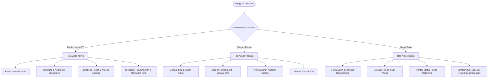
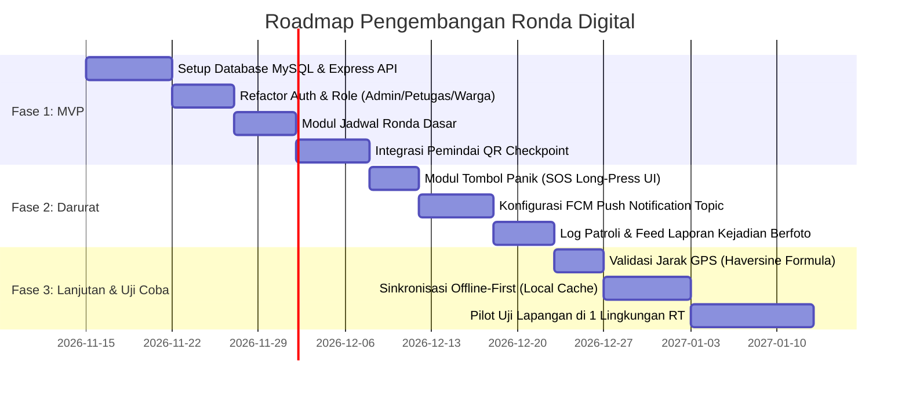

# PRODUCT REQUIREMENT DOCUMENT (PRD)
## Transformasi SensorLog Menjadi Ronda Digital (Siskamling Modern RT/RW)

---

### Informasi Dokumen
- **Judul Produk**: Ronda Digital — Siskamling Modern Lingkungan RT/RW
- **Inisiator / Pengembang**: Kelompok 4 · Teknik Komputer ITS
- **Basis Kode Awal**: Aplikasi `SensorLog` (`Tugas-4` Flutter Mobile App)
- **Status**: Perencanaan Arsitektur & Spesifikasi Kebutuhan (PRD)
- **Target Platform**: Android & iOS (Flutter), Backend (Node.js/Express/TypeScript + Prisma + MySQL)

---

## 1. Latar Belakang & Masalah

### 1.1 Masalah Siskamling Konvensional
Berdasarkan temuan lapangan pada sistem ronda lingkungan RT/RW saat ini:
1. **Jadwal Sering Lupa & Tukar Giliran Repot**: Pembagian giliran manual via kertas/grup WhatsApp sering terlewat, miskomunikasi, dan sulit mencari pengganti saat warga berhalangan.
2. **Tanpa Bukti Patroli Nyata**: Tidak ada verifikasi apakah petugas benar-benar berkeliling ke titik rawan (pos ronda, gang buntu, portal) atau hanya diam di pos ronda.
3. **Peringatan Lambat saat Kondisi Kritis**: Penggunaan kentongan atau pesan WhatsApp sering terlambat terbaca saat terjadi pencurian, kebakaran, atau kecurigaan tindak kriminal malam hari.
4. **Ketiadaan Riwayat & Arsip Laporan**: Catatan kejadian hilang begitu saja tanpa histori analitik untuk evaluasi keamanan lingkungan oleh pengurus RT.

### 1.2 Solusi: Ronda Digital
Memodifikasi fondasi aplikasi pencatat lapangan **SensorLog** yang sudah memiliki modul GPS, kamera, dan sensor perangkat menjadi aplikasi operasional keamanan lingkungan terpadu yang menyediakan:
1. **Jadwal Otomatis & Fleksibel**: Pembagian shift adil, push reminder terjadwal, dan fitur pengajuan tukar giliran antarwarga.
2. **Check-in Checkpoint Berbasis QR Code + GPS**: Verifikasi kehadiran patroli di pos/titik pantau secara objektif dengan time-based token dan validasi radius geofencing.
3. **Tombol Panik Terintegrasi (SOS Alert)**: Broadcast sirine darurat dan koordinat presisi langsung ke seluruh smartphone warga dalam radius RT/RW menggunakan Firebase Cloud Messaging (FCM).
4. **Log Patroli & Riwayat Kejadian Real-time**: Dashboard pemantauan dan laporan investigasi berfoto untuk Ketua RT.

---

## 2. Audit Kode & Strategi Transformasi Basis Kode SensorLog (`Tugas-4`)

Aplikasi `SensorLog` memiliki fondasi arsitektur **Clean Architecture sederhana (Presentation - Provider - Data/Repository - Service)** dengan library modern Flutter yang sangat kompatibel untuk dialihfungsikan ke **Ronda Digital**.

### 2.1 Matriks Pemanfaatan Komponen SensorLog

| Modul di SensorLog (`Tugas-4`) | Implementasi Asal di SensorLog | Transformasi Menjadi Ronda Digital | Status |
| :--- | :--- | :--- | :--- |
| **Location Service** (`location_service.dart`) | Mengambil koordinat GPS (`latitude`, `longitude`, `accuracy`) saat membuat catatan. | **1. Validasi Check-in**: Menghitung jarak Haversine antara GPS perangkat dengan koordinat titik checkpoint QR.<br>**2. Pelacak SOS**: Menyertakan koordinat langsung saat tombol panik ditekan. | **Diperluas** |
| **Image Service** (`image_service.dart`) | Mengambil foto lapangan via kamera dan kompresi file. | **Dokumentasi Laporan Kejadian & Bukti Ronda**: Petugas memotret temuan mencurigakan (pintu terbuka, orang asing, lampu mati). | **Diperluas** |
| **Sensor Service** (`sensor_service.dart`) | Membaca kompas (`flutter_compass`), kemiringan akselerometer (`sensors_plus`), dan baterai (`battery_plus`). | **Safety Monitoring Petugas**: Deteksi baterai sekarat saat patroli malam, serta pembacaan kompas/arah orientasi saat meninjau peta wilayah RT. | **Dipertahankan** |
| **Map Screen** (`map_screen.dart`, `flutter_map`) | Menampilkan pin catatan observasi pada OpenStreetMap. | **Peta Keamanan RT**: Menampilkan batas wilayah RT, titik-titik pos checkpoint (warna merah jika belum dipindai, hijau jika sudah), dan indikator darurat merah berkedip saat ada SOS aktif. | **Diperluas** |
| **UI Motion & Feedback** (`press_scale.dart`, `loading_button.dart`, `shimmer_skeleton.dart`) | Interaksi haptic feedback, scale button, dan transisi halus. | Digunakan langsung pada tombol **SOS Panik** (long press with haptic warning), tombol check-in, dan list laporan ronda. | **Digunakan Kembali 100%** |
| **Export Service** (`export_service.dart`) | Ekspor catatan observasi ke CSV via `share_plus`. | **Laporan Bulanan RT**: Ekspor rekapitulasi kehadiran ronda dan log kejadian untuk rapat warga/LPJ Ketua RT. | **Dipertahankan** |
| **Data Layer & Backend** (`supabase_service.dart`) | Supabase PostgreSQL + Auth privat perorangan. | Ditransformasikan menjadi arsitektur backend mandiri berbasis **Node.js + Express + TypeScript + Prisma ORM + MySQL** serta dukungan **Offline-first local cache** (SQLite/Hive) saat patroli di blind spot sinyal. | **Refactor Arsitektur** |

---

## 3. Pengguna & Matriks Hak Akses (RBAC)

Aplikasi Ronda Digital memiliki 3 tingkatan peran (*role-based access control*):



### 3.1 Detail Hak Akses

| Fitur / Modul | Admin (Ketua RT) | Petugas Ronda | Warga |
| :--- | :---: | :---: | :---: |
| Mengatur jadwal ronda & penugasan warga | ✅ Penuh | ❌ | ❌ |
| Mengajukan & menyetujui tukar giliran ronda | ✅ Menyetujui | ✅ Mengajukan | ❌ |
| Generate & cetak QR Code Checkpoint | ✅ Penuh | ❌ | ❌ |
| Pemindaian Check-in QR + Validasi GPS | ❌ (Kecuali giliran tugas) | ✅ Penuh | ❌ |
| Input Laporan Kejadian (Foto + Catatan + GPS) | ✅ Penuh | ✅ Penuh | ✅ Laporan Khusus |
| Mengaktifkan Tombol Panik (SOS Alarm) | ✅ | ✅ | ✅ |
| Menerima Push Notification Darurat (FCM) | ✅ | ✅ | ✅ |
| Monitoring Peta Patroli & Titik Pantau RT | ✅ Real-time | ✅ Selama shift | ✅ Status terverifikasi |
| Ekspor Laporan & Statistik Ronda | ✅ Penuh (CSV/PDF) | ❌ | ❌ |

---

## 4. Spesifikasi Kebutuhan Fungsional (Functional Requirements)

### 4.1 Modul 1: Manajemen Akun, Profil, & Scope Lingkungan RT
- **FR-AUTH-01**: Pengguna dapat masuk menggunakan Nomor WhatsApp / Email dan PIN/Password.
- **FR-AUTH-02**: Akun terikat ke metadata wilayah: `rt_id`, `rw_id`, `nomor_rumah`, dan `role` (Admin RT, Petugas Ronda, Warga).
- **FR-AUTH-03**: Pengguna dapat melihat identitas RT pengampu dan daftar kontak pengurus darurat lingkungan.

### 4.2 Modul 2: Penjadwalan Otomatis & Pertukaran Jadwal (Shift Swap)
- **FR-SCHED-01**: Admin dapat men-generate jadwal ronda berkala (mingguan/bulanan) dengan mendistribusikan seluruh kepala keluarga/warga secara adil.
- **FR-SCHED-02**: Notifikasi pengingat otomatis dikirim ke petugas: H-1 hari (19.00 WIB) dan H-2 jam sebelum ronda dimulai (21.00 WIB).
- **FR-SCHED-03**: Warga yang bertugas dapat mengajukan pertukaran jadwal (*shift swap request*) ke warga lain dengan menyertakan alasan.
- **FR-SCHED-04**: Jadwal resmi diperbarui otomatis setelah pihak penerima pertukaran dan Admin menyetujui.

### 4.3 Modul 3: Patroli & Validasi Checkpoint (QR Bertanda Waktu + GPS)
- **FR-PATROL-01**: Admin menentukan titik checkpoint fisik di lingkungan (misal: Pos Utama, Gapura Gang 1, Gardu PLN, Area Lapangan) beserta koordinat koordinat GPS target dan toleransi radius (misal: 25 meter).
- **FR-PATROL-02**: Aplikasi menyediakan pemindai QR Code bawaan (menggunakan kamera dari modul `ImageService` yang diperbarui).
- **FR-PATROL-03 (Anti-Fraud / Anti-Spoofing)**: QR Code checkpoint berupa *dynamic token* atau bertanda waktu (HMAC terenkripsi berbasis waktu) yang dicegah dari pemalsuan foto cetak statis atau titip absen.
- **FR-PATROL-04 (Geofencing Haversine)**: Saat QR dipindai, aplikasi memverifikasi lokasi GPS perangkat saat ini terhadap koordinat checkpoint:
  $$\text{Jarak} = \text{haversine}(\text{lat}_{\text{user}}, \text{lon}_{\text{user}}, \text{lat}_{\text{target}}, \text{lon}_{\text{target}}) \le \text{Threshold (25m)}$$
- **FR-PATROL-05**: Check-in berhasil akan merekam: `checkpoint_id`, `user_id`, `timestamp`, `lat_actual`, `lon_actual`, `accuracy`, dan status baterai perangkat.

### 4.4 Modul 4: Tombol Panik & Alarm Darurat (SOS Alert)
- **FR-SOS-01**: Halaman utama memiliki tombol darurat besar yang memerlukan penekanan tahan (*long press* 3 detik) disertai *haptic vibration* untuk mencegah ketidaksengajaan.
- **FR-SOS-02**: Saat terpicu, aplikasi langsung mengunci posisi GPS terkini dan memancarkan sinyal darurat ke backend API `/api/emergency/panic`.
- **FR-SOS-03**: Backend memancarkan push notification FCM prioritas tinggi (*high-priority data payload*) ke topik RT terkait (`/topics/rt_<rt_id>_emergency`).
- **FR-SOS-04**: Smartphone warga dan petugas ronda akan membunyikan nada alarm sirine darurat (bahkan saat mode hening/Do-Not-Disturb jika diizinkan sistem) serta membuka dialog pop-up yang memperlihatkan:
  - Nama & alamat warga pelapor
  - Titik lokasi darurat pada peta interaktif
  - Tombol pintas navigasi ke lokasi (Google Maps Intent) dan tombol telepon langsung.

### 4.5 Modul 5: Pencatatan Log Kejadian Lapangan & Kamera
- **FR-LOG-01**: Petugas ronda dapat membuat laporan insiden mencurigakan selama berkeliling dengan memilih kategori (Pencurian, Keributan, Kebakaran, Orang Mencurigakan, Kerusakan Fasilitas, Lainnya).
- **FR-LOG-02**: Laporan wajib menyertakan foto bukti langsung dari kamera (bukan galeri, untuk menjamin keaslian waktu nyata) menggunakan modul `ImageService` bawaan SensorLog.
- **FR-LOG-03**: Laporan menyertakan koordinat GPS otomatis, waktu, catatan deskriptif, dan arah kompas perangkat saat membidik foto.
- **FR-LOG-04**: Admin dan warga dapat melihat feed laporan kejadian pada tab Linimasa Lingkungan.

### 4.6 Modul 6: Dukungan Offline-First (Patroli di Blank Spot)
- **FR-OFFLINE-01**: Saat koneksi internet seluler terputus di sudut lingkungan, scan checkpoint dan laporan kejadian tetap dapat disimpan ke basis data lokal (SQLite / Hive).
- **FR-OFFLINE-02**: Tanda waktu lokal kriptografis dicatat saat kejadian berlangsung.
- **FR-OFFLINE-03**: Sinkronisasi otomatis (*background sync*) dijalankan segera setelah koneksi internet kembali pulih.

---

## 5. Kebutuhan Non-Fungsional (Non-Functional Requirements)

| Aspek | Spesifikasi Kebutuhan |
| :--- | :--- |
| **Latensi Notifikasi Darurat** | Pesan darurat SOS harus terdistribusi melalui FCM ke >95% gawai warga dalam waktu kurang dari **2,5 detik** dari penekanan tombol. |
| **Toleransi Akurasi GPS** | Filter penolakan check-in jika nilai `accuracy` GPS > 35 meter (indikasi sinyal GPS lemah/spoofed mock location). |
| **Efisiensi Baterai** | Pengambilan koordinat GPS menggunakan mode hemat daya (*balanced power accuracy*) di latar belakang, dan beralih ke *high accuracy* hanya saat proses pemindaian QR / pemicuan SOS. |
| **Keamanan Data** | Seluruh komunikasi HTTP dilindungi TLS 1.3 / HTTPS. Autentikasi API menggunakan JSON Web Token (JWT) dengan umur masa aktif terukur. |
| **Resiliensi Jaringan** | Mekanisme *idempotency key* pada pengiriman check-in agar tidak terjadi duplikasi log saat koneksi tidak stabil. |

---

## 6. Desain Arsitektur Teknis

### 6.1 Arsitektur Sistem Terintegrasi

```
┌────────────────────────────────────────────────────────┐
│            Aplikasi Mobile (Flutter Client)             │
│  - Presentation: Beranda, Peta RT, Scan QR, SOS, Jadwal │
│  - Providers: Auth, Patrol, Emergency, Schedule        │
│  - Local Cache (Offline-First): SQLite / Hive          │
│  - Services: Geolocator, Camera, SensorPlus, FCM Clt   │
└───────────────▲────────────────────────▲───────────────┘
                │ REST API (HTTPS)       │ WebSocket / FCM Topic
                ▼                        ▼
┌────────────────────────────────────────────────────────┐
│            Backend Service (Node.js + Express)          │
│  - Runtime: TypeScript + Express.js                    │
│  - ORM: Prisma ORM                                     │
│  - Engine Validasi: Time-based QR Verifier + Haversine │
│  - Notifier: Firebase Admin SDK (FCM)                  │
└───────────────────────────▲────────────────────────────┘
                            │ Prisma Client
                            ▼
┌────────────────────────────────────────────────────────┐
│               Database Relasional (MySQL)               │
│  - Users, RT_Profile, Checkpoints, Schedules,          │
│  - Patrol_Logs, Incidents, Emergency_Events            │
└────────────────────────────────────────────────────────┘
```

### 6.2 Skema Basis Data Relasional (MySQL + Prisma Schema)

Berikut rancangan skema relasional pengganti schema lama SensorLog:

```prisma
datasource db {
  provider = "mysql"
  url      = env("DATABASE_URL")
}

generator client {
  provider = "prisma-client-js"
}

enum Role {
  ADMIN_RT
  PETUGAS_RONDA
  WARGA
}

enum IncidentCategory {
  PENCURIAN
  KEBAKARAN
  KERIBUTAN
  ORANG_MENCURIGAKAN
  FASILITAS_RUSAK
  LAINNYA
}

enum SwapStatus {
  PENDING
  ACCEPTED
  REJECTED
  APPROVED_BY_ADMIN
}

model RTCommunity {
  id           String        @id @default(uuid())
  nomorRt      String        @map("nomor_rt") // Contoh: "004"
  nomorRw      String        @map("nomor_rw") // Contoh: "002"
  kelurahan    String
  users        User[]
  checkpoints  Checkpoint[]
  schedules    Schedule[]
  incidents    Incident[]
  emergencies  EmergencyEvent[]

  createdAt    DateTime      @default(now()) @map("created_at")

  @@map("rt_communities")
}

model User {
  id              String        @id @default(uuid())
  rtId            String        @map("rt_id")
  rtCommunity     RTCommunity   @relation(fields: [rtId], references: [id], onDelete: Cascade)
  namaLengkap     String        @map("nama_lengkap")
  nomorWhatsapp   String        @unique @map("nomor_whatsapp")
  passwordHash    String        @map("password_hash")
  alamatRumah     String        @map("alamat_rumah")
  role            Role          @default(WARGA)
  fcmToken        String?       @map("fcm_token")
  
  schedulesAsDuty Schedule[]    @relation("DutyOfficer")
  swapRequestsSent ShiftSwap[]  @relation("Requester")
  swapRequestsRcvd ShiftSwap[]  @relation("TargetUser")
  patrolLogs      PatrolLog[]
  incidentsReported Incident[]
  emergenciesTriggered EmergencyEvent[]

  createdAt       DateTime      @default(now()) @map("created_at")

  @@map("users")
}

model Checkpoint {
  id          String      @id @default(uuid())
  rtId        String      @map("rt_id")
  rtCommunity RTCommunity @relation(fields: [rtId], references: [id], onDelete: Cascade)
  kodeTitik   String      @map("kode_titik") // Contoh: "CP-POS-01"
  namaLokasi  String      @map("nama_lokasi") // "Pos Ronda Barat"
  latitude    Float
  longitude   Float
  radiusMeter Float       @default(25.0) @map("radius_meter")
  qrSecretKey String      @map("qr_secret_key") // Untuk dynamic HMAC validation

  patrolLogs  PatrolLog[]

  createdAt   DateTime    @default(now()) @map("created_at")

  @@map("checkpoints")
}

model Schedule {
  id          String      @id @default(uuid())
  rtId        String      @map("rt_id")
  rtCommunity RTCommunity @relation(fields: [rtId], references: [id], onDelete: Cascade)
  userId      String      @map("user_id")
  petugas     User        @relation("DutyOfficer", fields: [userId], references: [id])
  tanggalRonda DateTime   @map("tanggal_ronda") @db.Date
  jamMulai    String      @default("22:00") @map("jam_mulai")
  jamSelesai  String      @default("04:00") @map("jam_selesai")
  isCompleted Boolean     @default(false) @map("is_completed")

  swapRequests ShiftSwap[]

  @@map("schedules")
}

model ShiftSwap {
  id             String     @id @default(uuid())
  scheduleId     String     @map("schedule_id")
  schedule       Schedule   @relation(fields: [scheduleId], references: [id], onDelete: Cascade)
  requesterId    String     @map("requester_id")
  requester      User       @relation("Requester", fields: [requesterId], references: [id])
  targetUserId   String     @map("target_user_id")
  targetUser     User       @relation("TargetUser", fields: [targetUserId], references: [id])
  alasan         String     @db.Text
  status         SwapStatus @default(PENDING)
  createdAt      DateTime   @default(now()) @map("created_at")

  @@map("shift_swaps")
}

model PatrolLog {
  id           String      @id @default(uuid())
  checkpointId String      @map("checkpoint_id")
  checkpoint   Checkpoint  @relation(fields: [checkpointId], references: [id])
  userId       String      @map("user_id")
  petugas      User        @relation(fields: [userId], references: [id])
  scannedAt    DateTime    @default(now()) @map("scanned_at")
  latitudeUser Float       @map("latitude_user")
  longitudeUser Float      @map("longitude_user")
  distanceMeter Float      @map("distance_meter")
  batteryLevel Float?      @map("battery_level")
  syncStatus   String      @default("SYNCED") @map("sync_status") // PENDING, SYNCED

  @@map("patrol_logs")
}

model Incident {
  id          String           @id @default(uuid())
  rtId        String           @map("rt_id")
  rtCommunity RTCommunity      @relation(fields: [rtId], references: [id], onDelete: Cascade)
  userId      String           @map("user_id")
  reporter    User             @relation(fields: [userId], references: [id])
  category    IncidentCategory
  keterangan  String           @db.Text
  photoUrl    String           @map("photo_url")
  latitude    Float
  longitude   Float
  compass     Float?
  createdAt   DateTime         @default(now()) @map("created_at")

  @@map("incidents")
}

model EmergencyEvent {
  id          String      @id @default(uuid())
  rtId        String      @map("rt_id")
  rtCommunity RTCommunity @relation(fields: [rtId], references: [id], onDelete: Cascade)
  userId      String      @map("user_id")
  triggerBy   User        @relation(fields: [userId], references: [id])
  latitude    Float
  longitude   Float
  catatan     String?     @db.Text
  status      String      @default("ACTIVE") @map("status") // ACTIVE, RESOLVED
  triggeredAt DateTime    @default(now()) @map("triggered_at")
  resolvedAt  DateTime?   @map("resolved_at")

  @@map("emergency_events")
}
```

---

## 7. Rencana Pengembangan Bertahap (Roadmap)

Mengacu pada proposal PPT, pengerjaan dibagi menjadi 3 fase terukur:



### 7.1 Fase 1: MVP (Minimum Viable Product)
- **Tujuan**: Membangun alur dasar operasional ronda.
- **Deliverables**:
  1. Login dengan pemilihan peran (Admin RT, Petugas Ronda, Warga).
  2. Kalender jadwal ronda mingguan & tampilan petugas yang aktif malam ini.
  3. Pemindai QR bawaan untuk check-in di pos ronda.
  4. Pencatatan log kehadiran patroli tersimpan ke basis data.

### 7.2 Fase 2: Darurat & Respons Cepat
- **Tujuan**: Perlindungan real-time lingkungan terhadap ancaman keamanan.
- **Deliverables**:
  1. Tombol panik interaktif (tahan 3 detik dengan animasi feedback getar).
  2. Pengiriman koordinat lokasi otomatis ke server.
  3. Integrasi Firebase Cloud Messaging (FCM) topic broadcast per RT (`/topics/rt_<id>`).
  4. Nada alarm darurat & tampilan pop-up peringatan di perangkat warga.
  5. Fitur pelaporan kejadian berkamera (adaptasi langsung dari `ImageService` SensorLog).

### 7.3 Fase 3: Lanjutan & Uji Lapangan
- **Tujuan**: Keandalan tingkat lanjut di kondisi ekstrem dan verifikasi operasional.
- **Deliverables**:
  1. Validasi ganda: QR bertanda waktu + kalkulasi jarak radius GPS (anti titip absen).
  2. Mekanisme offline-first dengan antrean sinkronisasi otomatis saat terhubung sinyal.
  3. Uji coba penerapan langsung di 1 RT percontohan di Surabaya/kampus ITS.
  4. Pengumpulan feedback dari warga dan Ketua RT untuk penyempurnaan UI/UX.

---

## 8. Panduan Teknis Refactoring Kode Flutter (`Tugas-4` → Ronda Digital)

### 8.1 Pemetaan Struktur Berkas

```
SensorLog (Tugas-4)                         Ronda Digital (Target)
─────────────────────────────────           ────────────────────────────────────────
lib/data/services/location_service.dart  →  lib/data/services/location_service.dart (ditambah verifikasi Haversine)
lib/data/services/image_service.dart     →  lib/data/services/image_service.dart (untuk laporan insiden)
lib/data/services/sensor_service.dart    →  lib/data/services/sensor_service.dart (baterai & kompas)
lib/presentation/screens/capture/        →  lib/presentation/screens/incident/ (form laporan kejadian)
(BARU)                                   →  lib/presentation/screens/patrol/scan_qr_screen.dart (pemindai QR)
(BARU)                                   →  lib/presentation/screens/emergency/sos_screen.dart (tombol panik)
(BARU)                                   →  lib/presentation/screens/schedule/schedule_screen.dart (jadwal ronda)
lib/presentation/screens/map/            →  lib/presentation/screens/map/rt_map_screen.dart (peta pos ronda & SOS)
lib/presentation/widgets/motion/         →  lib/presentation/widgets/motion/ (tetap digunakan)
```

### 8.2 Modifikasi `pubspec.yaml`
Paket yang ditambahkan pada modul Flutter:
- `mobile_scanner: ^5.2.3` (atau `qr_code_scanner`): untuk memindai QR code checkpoint pos ronda.
- `firebase_core: ^3.6.0` & `firebase_messaging: ^15.1.3`: untuk notifikasi darurat SOS via topik RT.
- `audioplayers: ^6.1.0`: untuk memainkan suara sirine darurat di smartphone warga saat menerima alarm SOS.
- `sqflite: ^2.4.1` atau `hive_flutter: ^1.1.0`: untuk penyimpanan lokal offline-first.

---

## 9. Metrik Keberhasilan & Kriteria Penerimaan (Acceptance Criteria)

1. **Efektivitas Ronda**:
   - 100% titik checkpoint wajib terpantau dan terverifikasi di dashboard Ketua RT setiap malam.
   - Penurunan komplain jadwal terlupakan berkat notifikasi H-1 dan H-2 jam.
2. **Keandalan Check-in**:
   - Sistem menolak pemindaian QR jika jarak pengguna ke koordinat pos > 25 meter.
   - Check-in tetap berhasil dicatat di storage lokal meski perangkat dalam kondisi Airplane Mode / No Service, dan tersinkronisasi dalam waktu < 10 detik setelah online.
3. **Kecepatan Respon Darurat**:
   - Waktu dari penekanan tombol SOS hingga sirine berbunyi di gawai warga rata-rata < 3 detik.
   - Tingkat false-alarm mendekati 0% karena proteksi penekanan tahan 3 detik.

---
*PRD ini disusun sebagai acuan kerja implementasi teknis Kelompok 4 Teknik Komputer ITS dalam mentransformasikan SensorLog menjadi solusi nyata keamanan masyarakat.*
