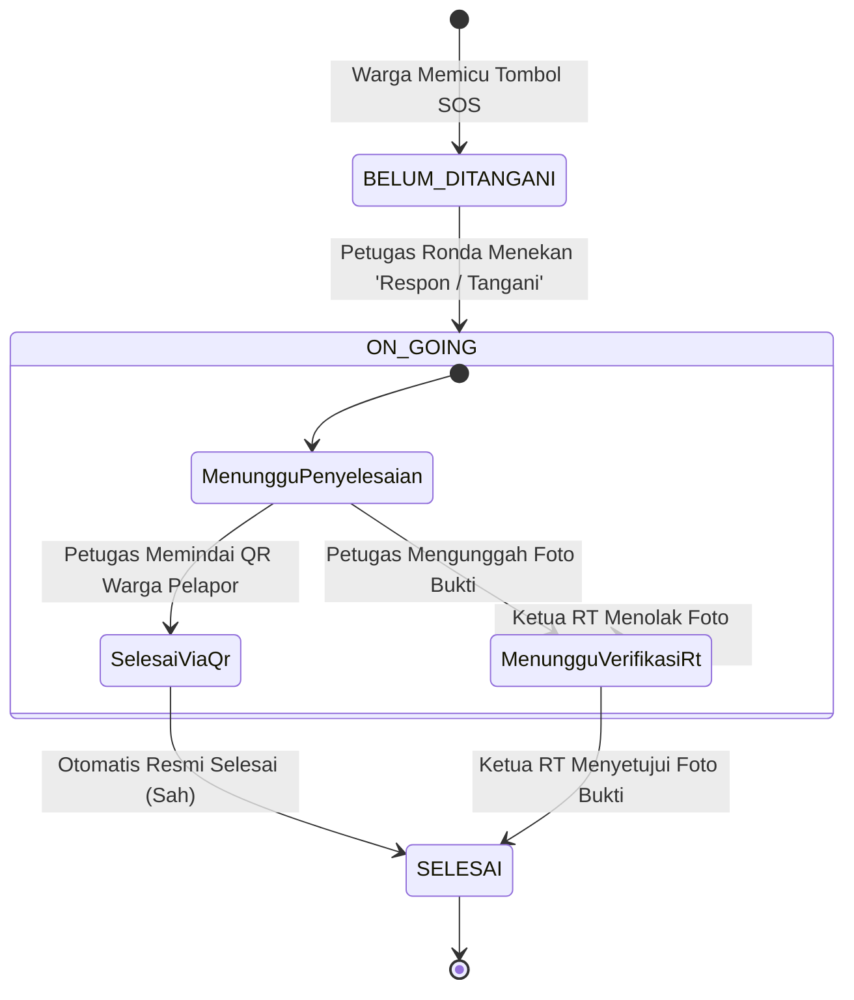

# PRODUCT REQUIREMENT DOCUMENT (PRD) — REVISI v2.0
## Ronda Digital (Siskamling Modern RT/RW)
**Kelompok 4 · Teknik Komputer Institut Teknologi Sepuluh Nopember**

---

### Informasi Dokumen
- **Judul Produk**: Ronda Digital — Siskamling Modern Lingkungan RT/RW
- **Inisiator**: Kelompok 4 Teknik Komputer ITS
- **Versi**: 2.0 (Revisi Autentikasi Terenkripsi, UI Spesifik Per-Role, & Siklus Hidup Verifikasi SOS Warga)
- **Status**: Spesifikasi Kebutuhan & Desain Teknis Resmi

---

## 1. Latar Belakang & Masalah Lapangan

Siskamling konvensional menghadapi kelemahan mendasar:
1. **Jadwal sering lupa & tukar giliran repot**: Koordinasi manual di grup WhatsApp sering menimbulkan miskomunikasi, dan sulit mencari pengganti saat berhalangan.
2. **Tanpa bukti patroli fisik**: Tidak ada jaminan petugas benar-benar berkeliling memeriksa pos-pos rawan di lingkungan.
3. **Peringatan darurat lambat & minim akuntabilitas penanganan**: Warga kesulitan menyebarkan alarm bahaya dengan cepat, dan penanganan insiden sering tidak terpantau status penyelesaiannya.
4. **Ketiadaan arsip laporan keamanan**: Catatan kejadian hilang tanpa evaluasi terstruktur oleh pengurus RT.

---

## 2. Fitur Utama & Prinsip Solusi

### 2.1 Autentikasi Nyata & Terenkripsi
- Sistem login mandiri yang aman menggunakan kredensial (Nomor WhatsApp / Identitas Terdaftar + PIN / Password).
- Password dienkripsi dengan *hashing cryptographic* (SHA-256 / PBKDF2 dengan salt) sebelum divalidasi.
- Tidak diperbolehkan memilih user secara sembarang dari antarmuka; sesi pengguna terikat token yang diverifikasi.

### 2.2 Antarmuka Pengguna Terpisah Berdasarkan Peran (Role-Tailored UI)
Setiap peran memiliki tampilan beranda dan fungsionalitas yang disesuaikan secara ketat sesuai kebutuhan informasinya:

1. **Tampilan Ketua RT (Admin / Pengawasan & Manajemen)**:
   - **Log & Laporan Terpusat**: Feed langsung pencatatan patroli petugas ronda di setiap pos.
   - **Pusat Komando Darurat (SOS)**:
     - Memantau status seluruh kejadian darurat di RT secara real-time.
     - Melakukan review dan verifikasi akhir (*approval*) untuk penanganan SOS yang diselesaikan via foto temuan.
   - **Persetujuan Perpindahan Jadwal (Shift Swap Approval)**: Panel pengesahan permohonan tukar jadwal yang telah disepakati kedua belah pihak warga/petugas.
   - **Rekapitulasi & Ekspor Laporan Bulanan (CSV/PDF)**.

2. **Tampilan Petugas Ronda (Operasional Lapangan)**:
   - **Tugas Shift Malam Ini**: Informasi jam patroli, rekan bertugas, dan tombol pengajuan tukar giliran.
   - **Pemindai Check-in Pos Ronda**: Memindai stiker QR fisik yang ditempel di setiap pos kamling/titik pantau, diverifikasi ganda dengan bukti lokasi GPS geofencing ($\le 25\text{ m}$).
   - **Respon & Penyelesaian SOS**:
     - Menerima alarm warga aktif dan mengubah status menjadi `ON-GOING` (Sedang Ditangani).
     - Menyelesaikan insiden darurat di tempat kejadian dengan memindai **QR Penyelesaian milik Warga Pelapor**, atau mengambil foto bukti lapangan jika warga tidak memungkinkan menunjukkan QR.
   - **Pelaporan Insiden Lapangan**: Input temuan mencurigakan berfoto + kompas arah.

3. **Tampilan Warga (Keselamatan & Transparansi)**:
   - **Tombol Panik Darurat (SOS)** berukuran besar dan mudah dijangkau di beranda utama (tahan 3 detik dengan getaran).
   - **QR Code Penyelesaian Darurat Pribadi**: Saat warga memicu SOS, aplikasi otomatis menampilkan kode QR unik. Kode ini wajib dipindai oleh petugas ronda yang datang menolong sebagai bukti sah bantuan telah tiba dan situasi aman.
   - **Status Ronda Malam Ini**: Mengetahui siapa tetangga yang sedang bertugas ronda malam ini beserta kontak daruratnya.
   - **Linimasa Riwayat Laporan Keamanan Lingkungan**.

---

## 3. Spesifikasi Mekanisme Check-in Pos Ronda (QR Fisik + Lokasi)

1. **Penempelan QR Fisik**: Setiap pos pantau fisik (misal: Pos 1 Gapura Utama, Pos 2 Gardu PLN, Pos 3 Portal Timur, Pos 4 Balai Warga) ditempeli stiker/kartu QR code unik.
2. **Kriptografi Bertanda Waktu**: QR fisik membawa kode pos dan rahasia yang menghasilkan dynamic HMAC atau token berotasi untuk mencegah foto salinan.
3. **Validasi Bukti Lokasi (Geofencing Haversine)**:
   - Saat petugas menekan tombol pemindaian QR di pos, aplikasi membaca posisi GPS perangkat melalui sensor bawaan.
   - Aplikasi menghitung jarak lengkung lingkaran besar (*Great-Circle Distance*) terhadap koordinat pos terdaftar:
     $$d = \text{haversine}(\text{lat}_{\text{petugas}}, \text{lon}_{\text{petugas}}, \text{lat}_{\text{pos}}, \text{lon}_{\text{pos}})$$
   - Syarat sah check-in:
     - $d \le 25\text{ meter}$ (berada tepat di area pos).
     - Akurasi GPS $\le 35\text{ meter}$ (mencegah manipulasi mock location / sinyal melayang).
4. **Dukungan Offline-First**: Jika titik pos berada di sudut tanpa sinyal seluler (*blank spot*), data check-in disimpan di antrean lokal (`OfflineSyncQueue`) dan otomatis terkirim saat sinyal kembali terdeteksi.

---

## 4. Spesifikasi Siklus Hidup Penanganan Darurat SOS

Setiap insiden darurat SOS yang dipicu warga memiliki status bertahap yang ketat demi transparansi dan akuntabilitas:

### 4.1 Tahapan Status SOS:
1. **`BELUM_DITANGANI` (Default / Merah)**:
   - Alarm sirine berbunyi di seluruh gawai warga dan petugas ronda.
   - Menampilkan koordinat GPS dan alamat warga pelapor.
2. **`ON-GOING` (Sedang Ditangani / Kuning)**:
   - Petugas ronda yang berada paling dekat menekan tombol *"Saya Merespon"*.
   - Warga dan Ketua RT mengetahui nama petugas yang sedang meluncur ke lokasi.
3. **Penyelesaian Darurat (Verifikasi Sah)**:
   - **Opsi Utama (Wajib diutamakan)**: Petugas yang tiba di rumah warga memindai **QR Code Penyelesaian Darurat** yang tampil di smartphone warga pelapor $\rightarrow$ Status seketika berubah menjadi **`SELESAI`**.
   - **Opsi Alternatif (Foto Bukti Lapangan)**: Jika warga dalam kondisi panik berat, terluka, atau gawainya tidak dapat diakses, petugas mengambil foto bukti penanganan di lokasi. Status berubah menjadi **`MENUNGGU_VERIFIKASI_RT`**.
4. **Persetujuan Akhir oleh Ketua RT**:
   - Untuk insiden berstatus `MENUNGGU_VERIFIKASI_RT`, Ketua RT meninjau foto bukti di dasbor pengawasan.
   - Jika foto sah dan situasi terbukti kondusif, Ketua RT menekan tombol *Approve* $\rightarrow$ Status resmi menjadi **`SELESAI`**.

---

## 5. Matriks Pengujian & Kriteria Keberhasilan (Acceptance Criteria)

1. **Keamanan Login**:
   - Pengguna tidak dapat masuk dengan password yang salah.
   - Sesi login mempertahankan peran pengguna yang sesuai di memori lokal.
2. **Kesesuaian Tampilan**:
   - Akun Ketua RT hanya menampilkan dasbor pengawasan, approval tukar jadwal, dan persetujuan foto SOS.
   - Akun Petugas Ronda menampilkan alat patroli (scan checkpoint, GPS, ambil tugas SOS, tukar shift).
   - Akun Warga menampilkan tombol SOS besar, QR verifikasi darurat warga, dan info petugas aktif.
3. **Validasi Check-in**:
   - Pemindaian QR pos dari jarak $> 25\text{ m}$ wajib ditolak oleh sistem.
4. **Akuntabilitas SOS**:
   - Tidak ada insiden SOS yang dapat diselesaikan tanpa salah satu dari:
     - Scan QR resmi dari warga pelapor, ATAU
     - Foto bukti yang telah disetujui (*approved*) oleh Ketua RT.
